# UI mockups

High-fidelity mockups of every screen of HexaBlock Suite (design task D12, [task document](../../odd/tasks/0003-ui-mockups.md)).
They guide the UI work; the Flutter screens follow them and take their colors and type from the same tokens.

- **Style:** dark arcade neon, with a light theme made from the same screens ([themes](#themes)). **Device:** portrait phone, drawn at 390 × 844 and checked at 360 × 780 ([verification](#verification)). **Exports:** PNG at 2× (780 × 1688).
- **Language:** the mockups are drawn in Spanish; two screens are also exported in English, and every string is listed in [English strings](#english-strings) (FR-10).

## How the mockups are built

Every screen is an HTML page in [`src/`](src/) built from shared files, so a change is made once:

| File | Holds |
|---|---|
| [`src/tokens.css`](src/tokens.css) | Design tokens (colors, type, radii, spacing), the shared components and the light theme. Each token maps to a value of the Flutter theme. |
| [`src/screens.css`](src/screens.css) | The phone frame: safe areas, status bar, navigation bar. |
| [`src/game.css`](src/game.css) | The game screen template: three fixed zones that every variant fills (S5). |
| [`src/result.css`](src/result.css) | The victory and defeat layout shared by every variant (FR-06, FR-07). |
| [`src/hexgrid.js`](src/hexgrid.js) | Draws boards from axial coordinates, the per-color glyphs, the stars and the shared icons. It holds no game rules. A different cell shape (ADR-0004) changes only this file. |
| [`src/levels.js`](src/levels.js) | The data of the level select: one screen for every level-based variant. |
| [`src/strings.js`](src/strings.js) | English strings; any mockup renders in English with `?lang=en`. |
| [`tokens.json`](tokens.json) | The tokens of `tokens.css` for both themes, for building the Flutter themes. |
| [`l10n/`](l10n/) | Every string of the mockups as Spanish and English ARB files, ready for Flutter's `gen-l10n`. |

To edit a mockup, open its HTML file in a browser, change it, and export the PNG again (a 390 × 844 viewport at device scale factor 2, for example with Chrome DevTools *Capture screenshot*). Add `?theme=light` or `?lang=en` to the address to export the other theme or language.

## Screens

| # | Screen | Image | Covers |
|---|---|---|---|
| — | Style guide: palette, variant colors, type, components | [style-guide.png](png/style-guide.png) | S1, C-28 |
| 01 | Home: suite name, sync status, settings, continue, and the selector of the four variants | [01-home.png](png/01-home.png) | S2, S3, FR-01 |
| 03 | Level select, Hexa Fit (tapping a locked level explains how to unlock it) | [03-level-select.png](png/03-level-select.png) | S4, FR-02 |
| 03b | Level select, Hexa Sort (same screen, other data) | [03b-level-select-sort.png](png/03b-level-select-sort.png) | S4, FR-02 |
| 04 | Game template: the three zones and what varies in each | [04-game-template.png](png/04-game-template.png) | S5, NFR-04 |
| 05 | Hexa Lines: radius-4 board, three pieces, drag or tap-then-tap | [05-hexa-lines.png](png/05-hexa-lines.png) | S6, FR-03, FR-30 to FR-37 |
| 06 | Hexa Fit: level figure, pieces, rotate, undo and redo, moves and time | [06-hexa-fit.png](png/06-hexa-fit.png) | S6, FR-03, FR-40 to FR-45 |
| 07 | Hexa Sort: stacks with a glyph per color, goals, next star threshold, next stack | [07-hexa-sort.png](png/07-hexa-sort.png) | S6, FR-03, FR-50 to FR-56 |
| 08 | Hexa Merge: numeric tiles, six swipe directions, target 2048, undo one move | [08-hexa-merge.png](png/08-hexa-merge.png) | S6, FR-03, FR-60 to FR-67 |
| 09 | Victory, Hexa Fit (a level with a next one) | [09-victory.png](png/09-victory.png) | S7, FR-06 |
| 10 | Defeat, Hexa Lines: no piece fits | [10-defeat.png](png/10-defeat.png) | S8, FR-07 |
| 11 | Settings: account and sync, music, effects, language, theme (dark, light, system), color symbols, credits, version | [11-settings.png](png/11-settings.png) | S9, FR-09, FR-10, FR-15 |
| 12 | Victory, Hexa Sort, last level: no "next level" | [12-victory-sort-last.png](png/12-victory-sort-last.png) | S7, FR-06, SORT-7 |
| 13 | Defeat, Hexa Sort: board full before the goals | [13-defeat-sort.png](png/13-defeat-sort.png) | S8, FR-07, SORT-5 |
| 14 | End of game, Hexa Merge: no swipe changes the board | [14-defeat-merge.png](png/14-defeat-merge.png) | S8, FR-64, MERGE-1 |
| 15 | Hexa Merge, target reached: the game goes on | [15-merge-target.png](png/15-merge-target.png) | S6, FR-64, MERGE-1 |
| 16 | Pause menu: resume, restart, settings, quit | [16-pause-menu.png](png/16-pause-menu.png) | S12 |
| 17 | Leave confirmation: what is lost and what is kept | [17-leave-confirm.png](png/17-leave-confirm.png) | S12 |
| 18 | States: sync, offline, level download and errors, first launch, invalid placement, color glyphs, back button | [18-states.png](png/18-states.png) | S13, FR-04, FR-14, FR-15, FR-32 |

Every screen also exists in the light theme, in [`png/light/`](png/light/) with the same file names (export any mockup with `?theme=light`). English: [`png/en/`](png/en/).

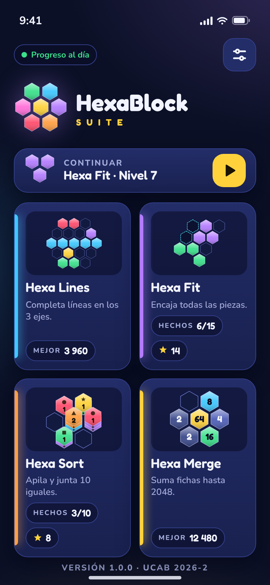 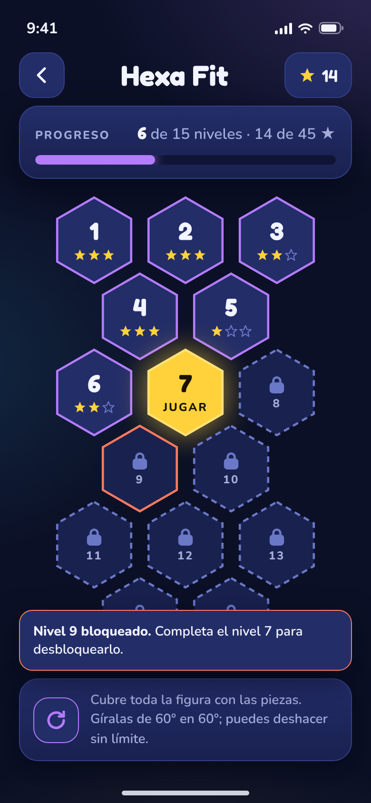 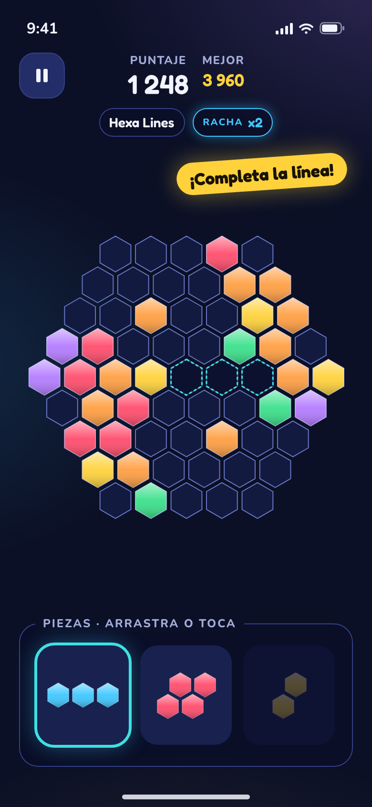 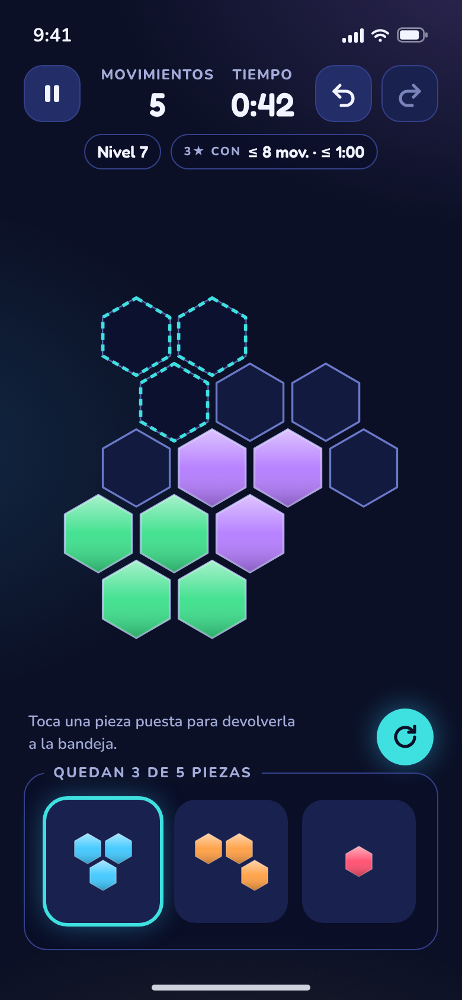

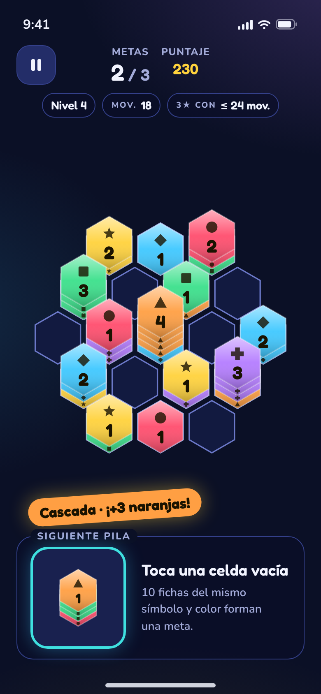 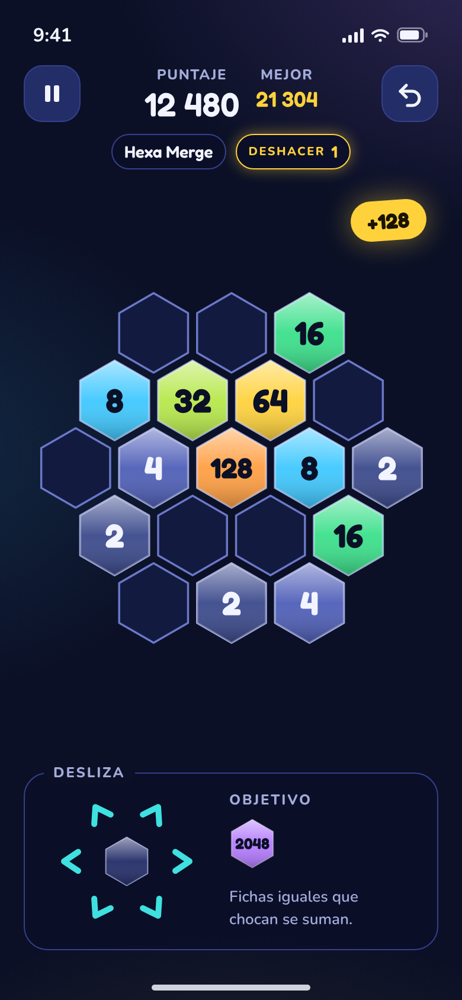 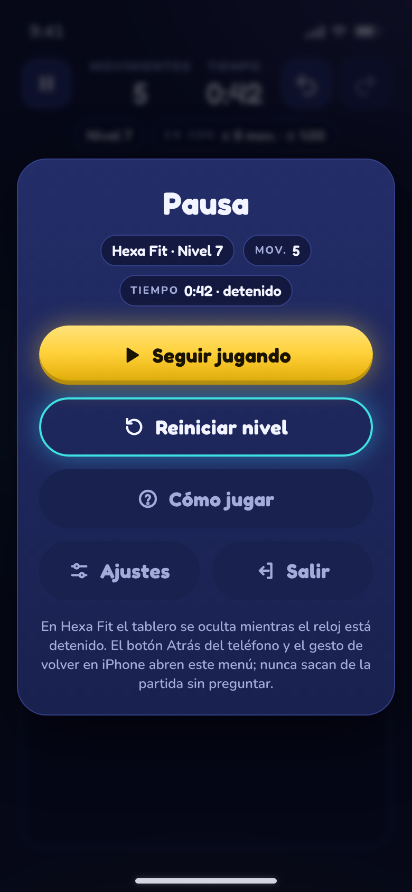 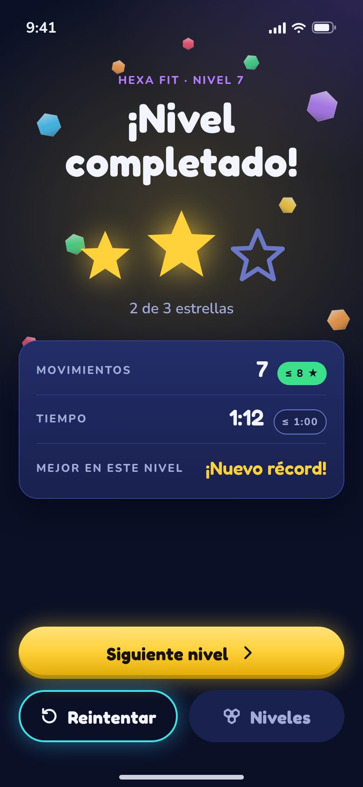

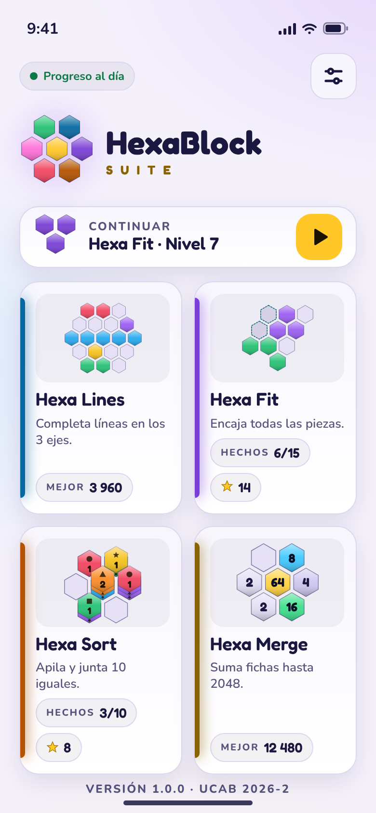 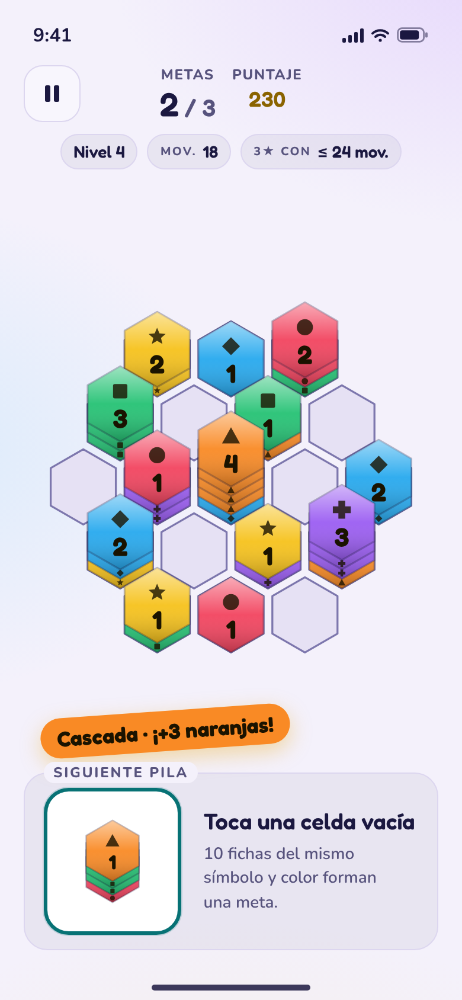 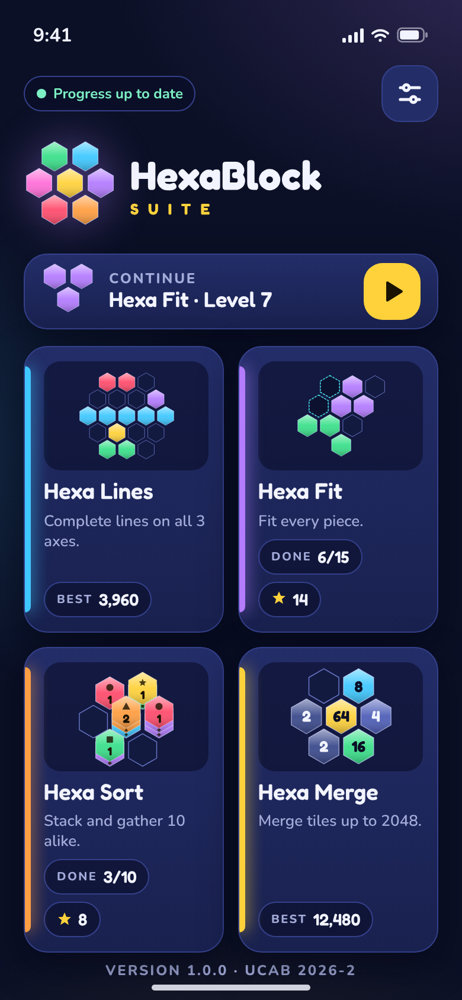 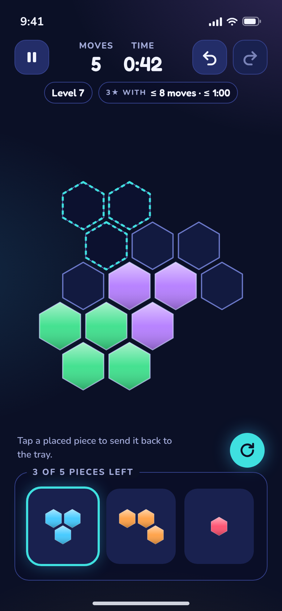

## Design notes

- **One template for four games.** The game screens share the top bar, the board zone and the tray zone. Undo appears only where the variant offers it (FR-37, FR-45, FR-56, FR-66), so the bar's actions are optional, not different layouts. The left stat is the variant's progress result (score, moves or goals); the right one is secondary.
- **Zone 3 varies by what the player plays next:** three pieces (Lines), the level's pieces (Fit), one stack (Sort, SORT-6) or the six swipe directions (Merge).
- **One result layout.** Victory and defeat share `result.css`. The primary button is always the forward action (next level, play again); the secondary ones go back (levels, home). After the last level the primary action is "See levels".
- **Leaving a game.** The system back button and the iOS swipe-back open the pause menu; they never leave a game without asking. Leaving a level-based game in progress asks for confirmation.
- **Game states follow `docs/game-rules.md`.** No two neighboring Hexa Sort stacks share a top color (SORT-3); the Hexa Lines defeat board has a free cell on every row of the three axes, all isolated (LINES-1, LINES-2); the Hexa Sort and Hexa Merge defeat boards are full with no two equal neighbors (SORT-5, MERGE-1). Each board was checked with a script.
- **The game never waits for the network.** Progress is saved on the phone first (FR-08); sync runs in the background and its status appears on the home and settings screens, never inside a game (FR-15).

### Proposal for the team

Hexa Lines and Hexa Merge are endless games that can last long, so screen 18 proposes that leaving one keeps it and "Continue" resumes it. No requirement asks for this yet; if the team agrees, it becomes a requirement in `docs/requirements.md`, otherwise it is removed from the mockups.

## Accessibility

- **Color is never the only signal.** Each Hexa Sort color has a glyph (circle, triangle, star, square, diamond, plus) on the top tile and on the edge of every layer (WCAG 1.4.1); earned and missing stars differ by shape (filled and outlined).
- **Contrast** (computed from `tokens.css` with the WCAG formula): text 11.6–17.2:1, muted text 5.7–8.4:1; Hexa Merge numbers 5.2–9.8:1 (dark text on every tile from 8 up); meaningful borders (`--line-strong`: empty cells, toggles, empty stars) 3.1–4.6:1 (WCAG 1.4.11).
- **Touch targets** are at least 48 × 48: icon buttons, the rotate button, the language selector; game cards and settings rows are touchable as a whole.
- **Input:** Hexa Lines accepts drag or tap the piece, then tap the cell (WCAG 2.5.7); the drag preview is drawn above the finger.

## Themes

The light theme only redefines tokens in `tokens.css` (`:root[data-theme="light"]`); no screen, component or board file changes. In the light theme every accent used as text keeps at least 4.5:1 on the light backgrounds, and meaningful borders 3.7:1. It is the same change the professor may ask for the day before the defense ("change the interface"), so in the app the theme is one `ThemeData` built from the same token names and chosen by one setting.

- **Choosing the theme:** Settings → *Pantalla e idioma* → *Tema*: dark (default), light, or system (follows the phone). The light export of Settings shows *Claro* selected.
- **Both themes in every export:** `png/` is dark and `png/light/` is light, file for file. A screen drawn behind a sheet (pause menu, leave confirmation) takes the same theme and language. The style guide lists the real values of the theme it is drawn in.
- **For Flutter:** [`tokens.json`](tokens.json) holds the same tokens as `tokens.css`: the shared type, radius and spacing, and every color for `dark` and `light`. The app builds one `ThemeData`, plus a `ThemeExtension` for the game colors, per theme from these names. Export it again when `tokens.css` changes.

## Verification

- Every screen was rendered at 390 × 844 and at 360 × 780 with a script that reports any element outside the screen. At 360 wide nothing overflows horizontally; the home screen, Settings and the Hexa Merge end screen scroll vertically on short phones, and the game boards scale to the board zone.
- Larger text sizes are left to the app: the HUD caps the text scale and the other screens scroll.

## English strings

The strings of every mockup are ready as ARB files for Flutter's `gen-l10n`: [`l10n/app_es.arb`](l10n/app_es.arb) (the template, with a description and typed placeholders for each key) and [`l10n/app_en.arb`](l10n/app_en.arb), 120 keys each. Both files have the same keys and the same placeholders, and every ICU message parses (checked with `@messageformat/parser`). They move to the app's `lib/l10n/` when the Flutter project exists. The app keeps its strings in ARB files with ICU placeholders and plurals (for example `{done} of {total} levels`, `{count, plural, one{1 piece left} other{{count} pieces left}}`); numbers use the locale's separator (3 960 in Spanish, 3,960 in English).

| Screen | Spanish (mockup) → English |
|---|---|
| 01 Home | Progreso al día → Progress up to date · Continuar → Continue · Nivel → Level · Completa líneas en los 3 ejes → Complete lines on all 3 axes · Encaja todas las piezas → Fit every piece · Apila y junta 10 iguales → Stack and gather 10 alike · Suma fichas hasta 2048 → Merge tiles up to 2048 · Mejor → Best · Hechos → Done · Versión → Version |
| 03 Level select | Progreso → Progress · {n} de {total} niveles → {n} of {total} levels · Jugar → Play · Nivel {n} bloqueado. Completa el nivel {m} para desbloquearlo → Level {n} locked. Complete level {m} to unlock it · Cubre toda la figura con las piezas. Gíralas de 60° en 60°; puedes deshacer sin límite → Cover the whole shape with the pieces. Rotate them in 60° steps; undo as much as you like · Coloca cada pila en una celda vacía. 10 fichas del mismo símbolo y color forman una meta → Place each stack on an empty cell. 10 tiles of the same symbol and color make a goal |
| 05–08, 15 Game | Puntaje → Score · Mejor → Best · Racha → Streak · ¡Completa la línea! → Complete the line! · Piezas · arrastra o toca → Pieces · drag or tap · Movimientos → Moves · Tiempo → Time · 3★ con → 3★ with · ≤ {n} mov. → ≤ {n} moves · Toca una pieza puesta para devolverla a la bandeja → Tap a placed piece to send it back to the tray · Quedan {n} de {total} piezas → {n} of {total} pieces left · Metas → Goals · Mov. → Moves · Cascada · ¡+{n} {color}! → Cascade · +{n} {color}! · Siguiente pila → Next stack · Toca una celda vacía → Tap an empty cell · Deshacer → Undo · Desliza → Swipe · Objetivo → Target · Fichas iguales que chocan se suman → Equal tiles merge when they meet · ¡Llegaste a 2048! → You reached 2048! · La partida sigue: suma todo lo que puedas → The game goes on: keep scoring |
| 09, 12 Victory | ¡Nivel completado! → Level complete! · ¡Completaste Hexa Sort! → You finished Hexa Sort! · {n} de 3 estrellas → {n} of 3 stars · Mejor en este nivel → Best on this level · ¡Nuevo récord! → New record! · Siguiente nivel → Next level · Ver niveles → See levels · Reintentar → Retry · Niveles → Levels · Inicio → Home |
| 10, 13, 14 Defeat | Sin espacio → Out of space · Ninguna de tus piezas cabe en el tablero → None of your pieces fits on the board · Tablero lleno → Board full · No quedan celdas vacías y te faltó {n} meta → No empty cell left; {n} goal short · Sin movimientos → No moves left · Ningún deslizamiento cambia el tablero → No swipe changes the board · Llegaste a 2048 en esta partida → You reached 2048 this game · Fin de la partida → Game over · Nivel no superado → Level failed · Jugar otra vez → Play again · Reintentar nivel → Retry level |
| 11 Settings | Ajustes → Settings · Cuenta y progreso → Account and progress · Tu progreso se guarda en el teléfono y se sincroniza → Your progress is saved on the phone and synced · Al día → Up to date · Sonido → Sound · Música (de fondo) → (Background) music · Efectos de sonido → Sound effects · Colocar, completar, fusionar → Place, clear, merge · Idioma → Language · Acerca de → About · Créditos y licencias → Credits and licenses · Fuentes, sonidos y referencias → Fonts, sounds and references · Versión → Version |
| 16, 17 Pause | Pausa → Paused · detenido → stopped · Seguir jugando → Keep playing · Reiniciar nivel → Restart level · Salir → Quit · ¿Salir del nivel? → Leave the level? · Se pierde este intento: {moves} movimientos y {time} → This attempt is lost: {moves} moves and {time} · Tus estrellas y récords anteriores se mantienen → Your earlier stars and records are kept · Salir sin guardar el intento → Leave without saving the attempt |
| 18 States | Sincronizando… → Syncing… · Sin conexión · guardado en el teléfono → Offline · saved on the phone · No se pudo sincronizar · Reintentar → Sync failed · Retry · Invitado · inicia sesión para guardar en la nube → Guest · sign in to save in the cloud · {n} niveles nuevos de {game} descargados → {n} new {game} levels downloaded · Cargando nivel {n}… → Loading level {n}… · No se pudieron bajar los niveles nuevos. Los que ya tienes siguen disponibles → The new levels could not be downloaded. The ones you have are still available · Nuevo → New |

## Out of scope (follow-up)

Sign-in, register and leaderboard screens (FR-11, FR-13) are drawn once the API contract (D5) defines the data they show. The credits screen follows `THIRD_PARTY_NOTICES.md` once sounds and music are chosen.

## Credits

Fredoka and Nunito fonts (SIL Open Font License 1.1, files and licenses in [`src/fonts/`](src/fonts/)); axial hex coordinates after Red Blob Games, *Hexagonal Grids*. See [THIRD_PARTY_NOTICES.md](../../THIRD_PARTY_NOTICES.md).
