# UI mockups

High-fidelity mockups of every screen of HexaBlock Suite (design task D12, [task document](../../odd/tasks/0003-ui-mockups.md)).
They guide the UI work; the Flutter screens follow them and take their colors and type from the same tokens.

- **Style:** dark arcade neon. **Device:** portrait phone, 390 × 844 (iPhone 14/15). **Exports:** PNG at 2× (780 × 1688).
- **Language:** the mockups are drawn in Spanish; the [English strings](#english-strings) of each screen are listed below (FR-10).

## How the mockups are built

Every screen is an HTML page in [`src/`](src/) that reuses four shared files, so a change is made once:

| File | Holds |
|---|---|
| [`src/tokens.css`](src/tokens.css) | Design tokens (colors, type, radii, spacing) and shared components. Each token maps to a value of the Flutter theme. |
| [`src/screens.css`](src/screens.css) | The phone frame: safe areas, status bar, navigation bar. |
| [`src/game.css`](src/game.css) | The game screen template: three fixed zones that every variant fills (S5). |
| [`src/hexgrid.js`](src/hexgrid.js) | Draws hexagonal boards from axial coordinates, plus the shared icons. It holds no game rules. A different cell shape (ADR-0004) changes only this file. |

To edit a mockup, open its HTML file in a browser, change it, and export the PNG again (a 390 × 844 viewport at device scale factor 2, for example with Chrome DevTools *Capture screenshot*).

## Screens

| # | Screen | Image | Covers |
|---|---|---|---|
| — | Style guide: palette, variant colors, type, components | [style-guide.png](png/style-guide.png) | S1, C-28 |
| 01 | Home: suite name, sound and settings, continue the last level, play | [01-home.png](png/01-home.png) | S2, FR-01 |
| 02 | Game select: the four variants with a preview and the best result | [02-game-select.png](png/02-game-select.png) | S3, FR-01 |
| 03 | Level select (Hexa Fit; Hexa Sort reuses it with its accent and data) | [03-level-select.png](png/03-level-select.png) | S4, FR-02 |
| 04 | Game template: the three zones and what varies in each | [04-game-template.png](png/04-game-template.png) | S5, NFR-04 |
| 05 | Hexa Lines: radius-4 board, three pieces, score and streak, no undo | [05-hexa-lines.png](png/05-hexa-lines.png) | S6, FR-03, FR-30 to FR-37 |
| 06 | Hexa Fit: level figure, pieces, rotate, undo and redo, moves and time | [06-hexa-fit.png](png/06-hexa-fit.png) | S6, FR-03, FR-40 to FR-45 |
| 07 | Hexa Sort: radius-2 board with stacks, goals, the next stack, no undo | [07-hexa-sort.png](png/07-hexa-sort.png) | S6, FR-03, FR-50 to FR-56 |
| 08 | Hexa Merge: numeric tiles, six swipe directions, target 2048, undo one move | [08-hexa-merge.png](png/08-hexa-merge.png) | S6, FR-03, FR-60 to FR-66 |
| 09 | Victory (Hexa Fit): stars, moves and time against the level's par, next level | [09-victory.png](png/09-victory.png) | S7, FR-06 |
| 10 | Defeat (Hexa Lines): no piece fits, score and best, retry | [10-defeat.png](png/10-defeat.png) | S8, FR-07 |
| 11 | Settings: music, sound effects, language, credits, version | [11-settings.png](png/11-settings.png) | S9, FR-09, FR-10 |

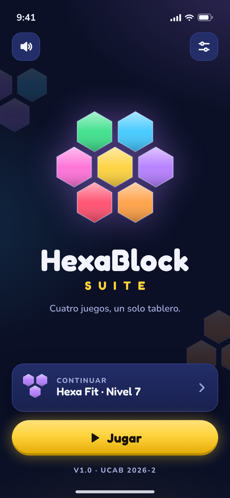 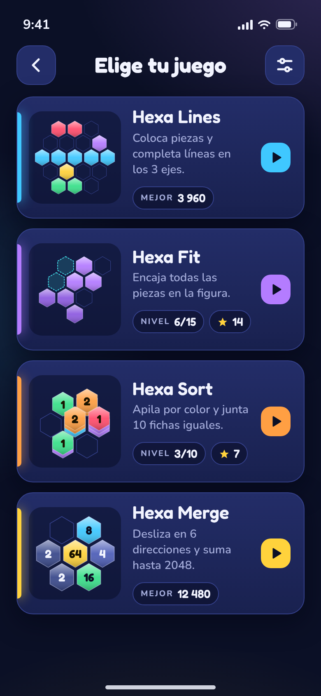 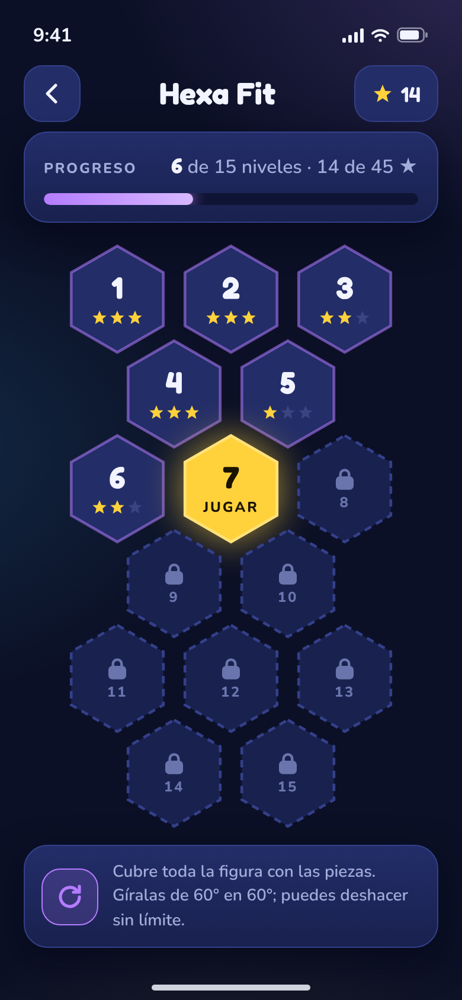 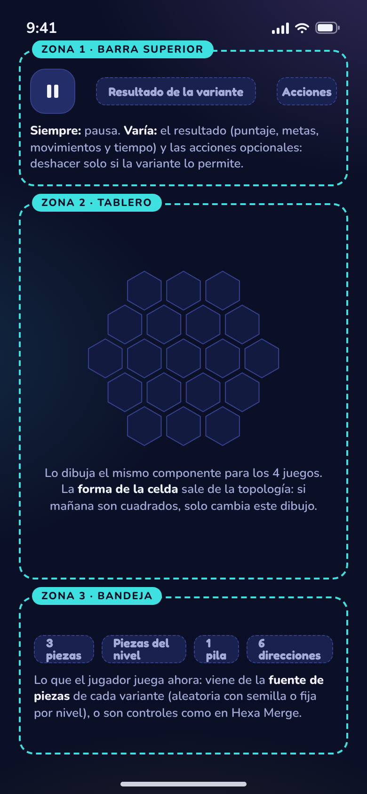

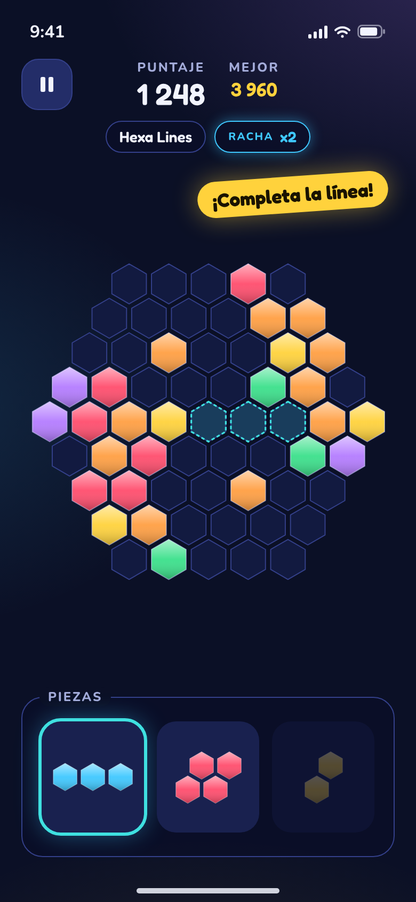 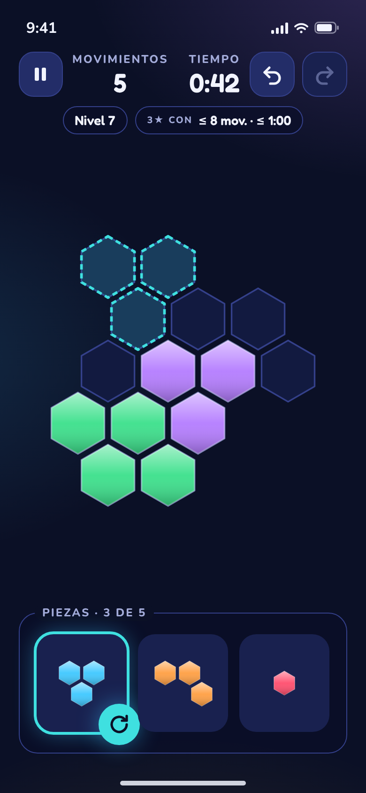 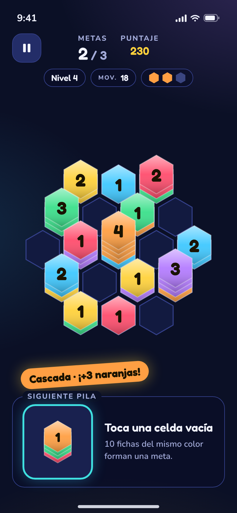 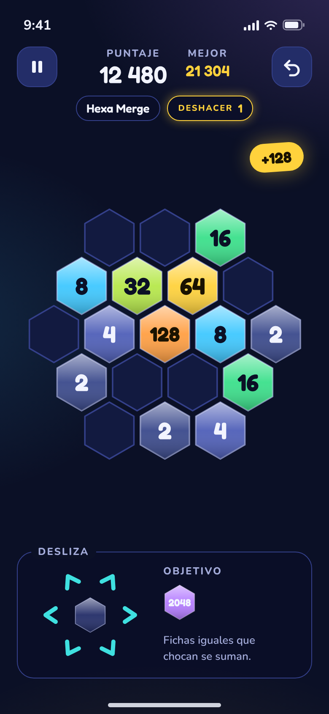

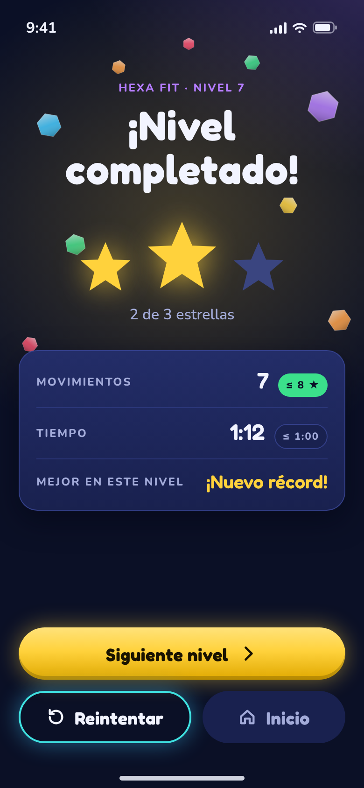 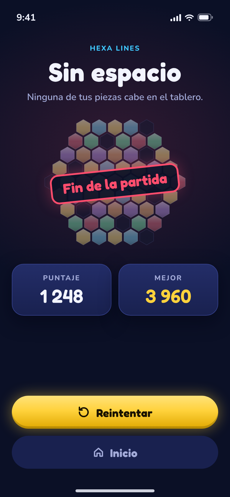 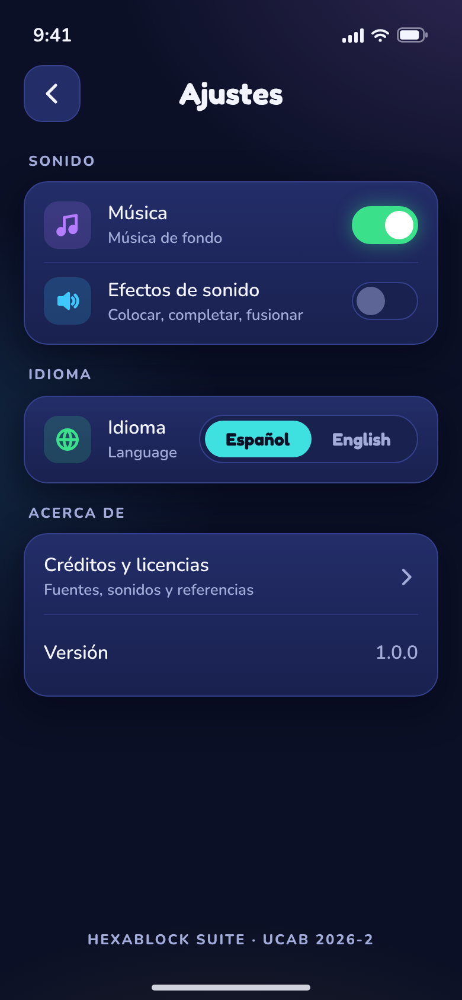

## Design notes

- **One template for four games.** The game screens share the top bar, the board zone and the tray zone. Undo appears only where the variant offers it (FR-37, FR-45, FR-56, FR-66), so the bar's actions are optional, not different layouts.
- **Zone 3 varies by what the player plays next:** three pieces (Lines), the level's pieces (Fit), one stack (Sort, rule SORT-6) or the six swipe directions (Merge).
- **Game states are consistent with the rules in `docs/game-rules.md`:** the Hexa Sort board has no two neighboring stacks with the same top color (the state after a cascade, SORT-3), and the Hexa Lines defeat board has a free cell on every row of all three axes, all isolated, so no line is complete and no piece fits (LINES-1, LINES-2).
- **Accessibility:** touch targets are at least 48 × 48; glow marks only what the player should touch or celebrate. A symbol per color for Hexa Sort (color blindness) is left for the domain model (D1).

## English strings

| Screen | Spanish (mockup) → English |
|---|---|
| 01 Home | Cuatro juegos, un solo tablero → Four games, one board · Continuar → Continue · Nivel → Level · Jugar → Play |
| 02 Game select | Elige tu juego → Choose your game · Coloca piezas y completa líneas en los 3 ejes → Place pieces and complete lines on all 3 axes · Encaja todas las piezas en la figura → Fit every piece into the shape · Apila por color y junta 10 fichas iguales → Stack by color and gather 10 of a kind · Desliza en 6 direcciones y suma hasta 2048 → Swipe in 6 directions and reach 2048 · Mejor → Best · Nivel → Level |
| 03 Level select | Progreso → Progress · 6 de 15 niveles → 6 of 15 levels · Jugar → Play · Cubre toda la figura con las piezas. Gíralas de 60° en 60°; puedes deshacer sin límite → Cover the whole shape with the pieces. Rotate them in 60° steps; undo as much as you like |
| 05–08 Game | Puntaje → Score · Mejor → Best · Racha → Streak · ¡Completa la línea! → Complete the line! · Piezas → Pieces · Movimientos → Moves · Tiempo → Time · 3★ con → 3★ with · Metas → Goals · Mov. → Moves · Cascada → Cascade · Siguiente pila → Next stack · Toca una celda vacía → Tap an empty cell · 10 fichas del mismo color forman una meta → 10 tiles of one color make a goal · Deshacer → Undo · Desliza → Swipe · Objetivo → Target · Fichas iguales que chocan se suman → Equal tiles merge when they meet |
| 09 Victory | ¡Nivel completado! → Level complete! · 2 de 3 estrellas → 2 of 3 stars · Mejor en este nivel → Best on this level · ¡Nuevo récord! → New record! · Siguiente nivel → Next level · Reintentar → Retry · Inicio → Home |
| 10 Defeat | Sin espacio → Out of space · Ninguna de tus piezas cabe en el tablero → None of your pieces fits on the board · Fin de la partida → Game over · Reintentar → Retry · Inicio → Home |
| 11 Settings | Ajustes → Settings · Sonido → Sound · Música (de fondo) → (Background) music · Efectos de sonido → Sound effects · Colocar, completar, fusionar → Place, clear, merge · Idioma → Language · Acerca de → About · Créditos y licencias → Credits and licenses · Fuentes, sonidos y referencias → Fonts, sounds and references · Versión → Version |

## Out of scope (follow-up)

Sign-in, register and leaderboard screens (FR-11, FR-13) are drawn once the API contract (D5) defines the data they show.

## Credits

Fredoka and Nunito fonts (SIL Open Font License 1.1, files and licenses in [`src/fonts/`](src/fonts/)); axial hex coordinates after Red Blob Games, *Hexagonal Grids*. See [THIRD_PARTY_NOTICES.md](../../THIRD_PARTY_NOTICES.md).
